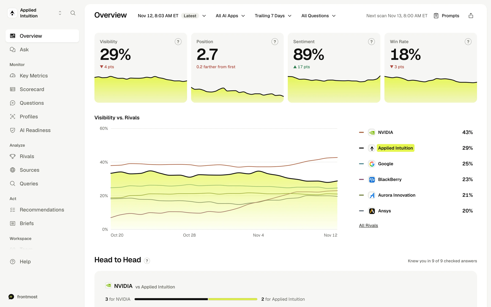

<p align="center">
  <a href="https://frontmost.ai">
    
  </a>
</p>

<p align="center">AI Search Intelligence for AI-Native Teams</p>

<h1 align="center">Give your agents the data to win you customers in AI search.</h1>

<p align="center">
  You run the business. Your agents can take on the AI search work.<br>
  Built for solo founders, one-person marketing teams, and agent-run businesses.
</p>

<p align="center">
  <a href="https://frontmost.ai/headless-ai-visibility"><strong>Set up Frontmost AI with your agent</strong></a>
  &nbsp; · &nbsp;
  <a href="https://github.com/frontmost-ai/aeo-skills">Install the AI search skills</a>
  &nbsp; · &nbsp;
  <a href="https://frontmost.ai/connect">Connect your AI</a>
</p>

## Your agent owns your AI search strategy

Frontmost AI helps founders get their businesses recommended in ChatGPT and other AI apps.
Your agent works from saved answers: where AI mentions you, who it recommends instead, and which pages it cites.

Give that data to the agent you already use. It can find gaps, draft pages and outreach, and compare later results.
You decide what goes live.

Frontmost AI is a headless AI visibility platform. Your agent can use it through a connector, API, or command line.
The web app is there when you want to look.

<a href="https://frontmost.ai/headless-ai-visibility">
  
</a>

## Start with your agent

Paste this into Claude Code, Codex, or Cursor:

```text
Follow https://frontmost.ai/auth.md and set up Frontmost AI for my business. Then tell me where ChatGPT leaves us out.
```

You sign in, choose a plan, and enter a card. Your agent handles setup and starts the first scan.

## Open-source tools

| Project | What it gives your agent |
| --- | --- |
| [AEO skills](https://github.com/frontmost-ai/aeo-skills) | 19 skills for AI search marketing. 13 work without a Frontmost AI account. |
| [Frontmost AI CLI](https://github.com/frontmost-ai/cli) | Your Frontmost AI questions, answers, and results from the terminal. |

Coverage includes ChatGPT, Gemini, Google AI Overviews, Google AI Mode, Perplexity, and Microsoft Copilot, depending on your plan.

---

[Website](https://frontmost.ai) · [How we measure](https://frontmost.ai/method) · [Contact](https://frontmost.ai/contact)
